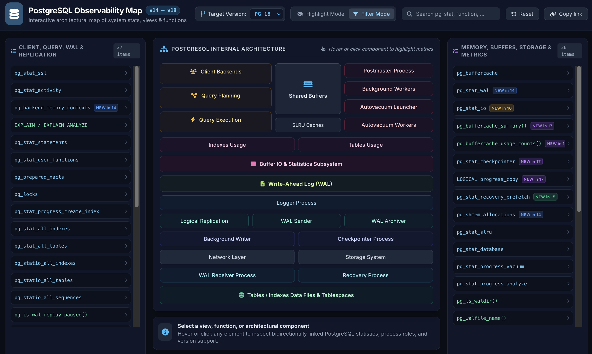

# 🐘 PostgreSQL Observability Architectural Map
**Version 1.0.0** 🎃 &nbsp; [](LICENSE)

Interactive map of PostgreSQL system views, functions, and processes for observability. 
It shows how `pg_stat_*`, I/O, WAL, replication, autovacuum, and memory components connect,
with version-aware filtering and direct links to official documentation.



---

## 🌐 Live Dashboard & Usage

Published on GitHub Pages: 👉  **[https://meob.github.io/pg-observability-map/](https://meob.github.io/pg-observability-map/?lists=720&ver=18&mode=hide)**

Select a view, function, or architectural component,
hover or click any element to inspect bidirectionally linked PostgreSQL statistics, process roles, and version support.

### Features

- Interactive diagram of PostgreSQL internals
- Version filter, with "Highlight" or "Filter" mode
- Bidirectional linking between architecture cards and system stats
- Direct links to `postgresql.org/docs` on each item
- Search across views/functions
- Deep linking via `?ver=`, `?sel=`, `?mode=` (`dim` or `hide`), and `?lists=` (e.g. `?lists=720`, `?lists=35vh`, or `?lists=full`)

### How to read

- **Views**: shown in `sky-300` (e.g. `pg_stat_*`), **Functions**: in `emerald-300`
- **NEW in X**: introduced in that PostgreSQL version
- **REMOVED in X**: removed starting from that version
- **Lock icon**: not available in the selected target version (use Highlight/Filter mode)
- **Requires extension**: item comes from an extension (links to its docs)

---

## 📂 Structure

```
docs/
├── index.htm                    # Main page
├── js/app.js                    # Application logic
├── data/pg_observability.json   # Data
└── glider18.png                 # favicon
```

### Data

All views/functions are defined in `docs/data/pg_observability.json`:
- `sinceVersion`: introduction version (e.g. `9.5`, `14`)
- `removedVersion`: `null` if still present, set if removed
- `docsUrl`: link to official docs
- `sections`: links to diagram components

---

## 🛠️ Running locally

Since data is loaded via `fetch()`, use a local HTTP server:

```bash
cd docs
python3 -m http.server 8000
```

Open [http://localhost:8000](http://localhost:8000).

If you publish this page, please remove the analytics script or replace the `data-website-id` with your own Umami ID.
Umami functions without cookies and processes no personal data, no cookie consent banner is required.


### Customizing

Add/edit entries in `docs/data/pg_observability.json`. Keep descriptions short and links to official documentation.

---

## 🧠 Development Notes

Concept inspired by Alexey Lesovsky's pgstats.dev

This project was developed through iterative collaboration with generative AI tools. AI assistance was used for implementation, refactoring, and debugging, while overall design decisions, customization, validation, and final integration were performed by the author.

---

## 🔗 Links and References
The original project and the live version are curated by Meo.
- [Your PostgreSQL Stinks!](https://www.meo.bogliolo.name/white/unix/trans.htm#post) - PostgreSQL Release Overview.
- [Meo's Personal Website (EN)](https://www.meo.bogliolo.name/en/)

External references:
- [Official documentation (PostgreSQL)](https://www.postgresql.org/docs/current/internals.html) 
- [THE PostgreSQL Encyclopedia (pgPedia)](https://pgpedia.info/)

---

## 📜 License
Distributed under the **Apache 2.0** license. See the `LICENSE` file for details.
